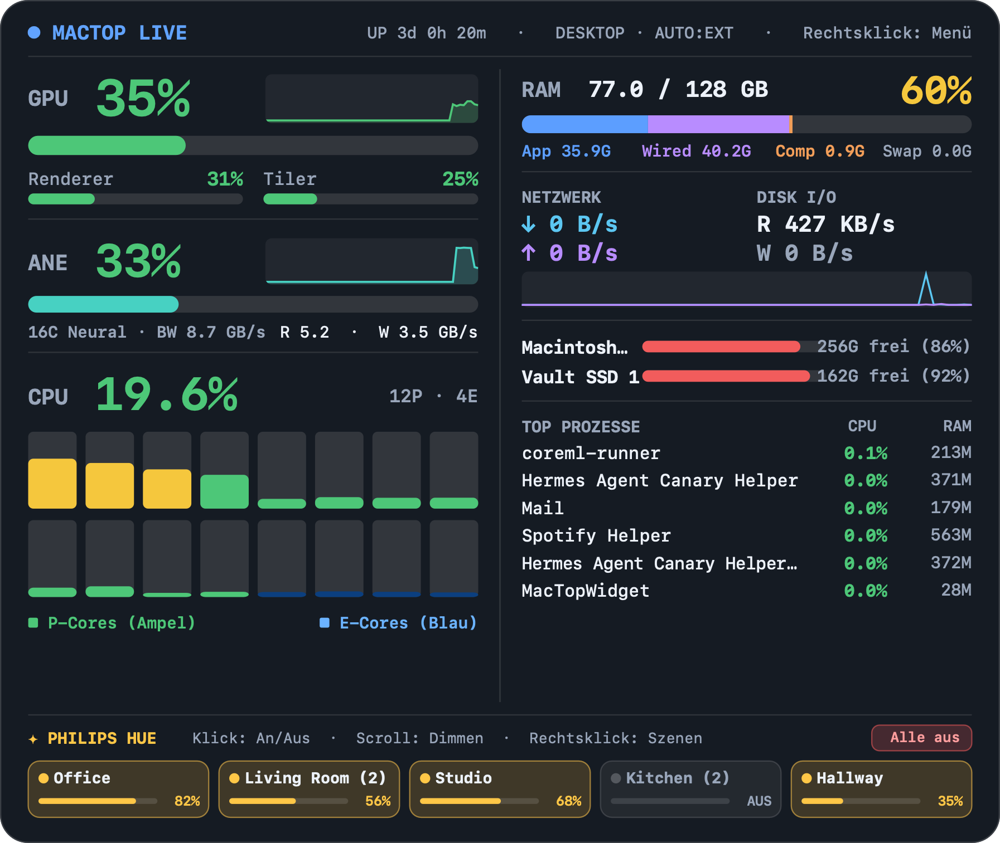

# MacTop Desktop

**Real-time Apple Silicon system monitor + local Philips Hue control anchored right on your macOS desktop — GPU, Neural Engine (ANE), P/E-Core CPU, RAM, Network, Disk I/O, Top Processes, and Hue rooms/scenes in a single ~460 KB native Swift binary. No Xcode project, no Electron, no `sudo`.**

<p align="center">
  
</p>

<p align="center">
  
  
  
  
  
  
</p>

---

## Why MacTop Desktop?

macOS's native WidgetKit (`chronod`) aggressively throttles background widget timelines to 5–15 minute budgets, strips full colors in dimmed desktop mode, and blocks cross-process inspection in the App Sandbox.

**MacTop Desktop (`MacTopWidget/`)** solves all of that with a pure AppKit desktop-layer window (`CGWindowLevelForKey(.desktopIconWindow) + 1`) over native macOS `NSVisualEffectView` blur glass:

- **True 1-second live telemetry** (`0.5 s` / `1.0 s` / `2.0 s` selectable) at **< 0.5 % CPU** overhead and ~60 MB RSS.
- **Behaves like a native desktop widget:** no Dock icon, no menu bar clutter, never steals keyboard focus, stays behind regular app windows, and remains stationary across Spaces & Mission Control.
- **Unthrottled Apple Neural Engine (ANE) monitoring without `sudo`:** reads live PMP voltage-floor residencies (`SOC Floor / ANE-*` & `ANE0`) and fabric bandwidth histograms (`AF BW` / `DCS BW`) directly via `libIOReport` — working even on M4 / macOS 26–27 where user-space `Energy Model → ANE` counters read zero.
- **Optional Philips Hue Smart-Home Bar (local CLIP API v2):** auto-discovers your local Hue Bridge via mDNS (`_hue._tcp`), pairs with a single link-button press (no cloud account), and renders an adaptive multi-row room grid right inside the widget — automatically hiding itself when you're on the road (14" MacBook solo or bridge unreachable) or whenever toggled off in the context menu.
- **Automatic Multi-Monitor & Laptop Profile (`AUTO:EXT` / `AUTO:14"`):** detects hot-plugging between large external displays (e.g., 49"–55" ultrawides at `XL 115 %`) and built-in MacBook screens (`85 %`), remembering independent scale factors and screen coordinates per display profile.

*(Also included in this repository: **`MacTopKit/`**, a companion standalone **WidgetKit** implementation in 4 widget sizes — Medium, Large, Extra Large, and Extra Large Portrait — built directly with `swiftc` without an `.xcodeproj`.)*

---

## Metrics & Controls at a Glance

| Left Column (Compute) | Right Column (Memory, I/O & Processes) |
|---|---|
| **GPU:** Total Device %, 60 s live sparkline, Renderer % & Tiler % bars (`IOAccelerator`) | **RAM:** Segmented bar (`App` / `Wired` / `Compressed`), total GB, and `Swap` (`host_statistics64`) |
| **ANE (Neural Engine):** Live utilization %, 60 s sparkline, detected core count (`H11ANEIn`), and live Read/Write fabric bandwidth in GB/s (`libIOReport`) | **Network & Disk I/O:** Live download/upload throughput + 60 s dual sparkline (`en*`/`bridge*`) and storage Read/Write rates (`IOBlockStorageDriver`) |
| **CPU:** Total % (`sumBusy / sumTicks`) + 2×8 vertical per-core bars with **P-Cores** (green/yellow/red traffic light) and **E-Cores** (blue) | **Internal Volumes & Top Processes:** Free disk space bars + top 6 live processes by CPU % and physical memory footprint (`proc_pid_rusage`) |

### Optional Bottom Section: Philips Hue (`✦ PHILIPS HUE`)
- **Zero-config discovery & pairing:** Right-click → **✦ Philips Hue → Hue Bridge verbinden…**, press the bridge link button once. Credentials stay local in macOS `UserDefaults`.
- **Direct desktop controls:**
  - **Left-click** any room tile to toggle On/Off (optimistic UI + live state sync).
  - **Scroll** over any room tile to smoothly dim up/down.
  - **Right-click** any room tile to toggle/dim **individual lights** inside multi-light rooms (e.g., `Living Room (2)`), jump to brightness presets (`10–100 %`), or activate saved **Hue Scenes**.
  - **All Off (`Alle aus`)** button on the right turns off all rooms at once.
- **Smart auto-hide & manual toggle:** Automatically collapses when the bridge is unreachable or when running solo on a MacBook display — and can be toggled on/off anytime from the right-click menu.

---

## Quick Start (`MacTopWidget` — Live Desktop Monitor)

### Requirements
- macOS on **Apple Silicon** (M1 / M2 / M3 / M4+)
- Xcode Command Line Tools (`xcode-select --install` — only `swiftc` is needed, no full Xcode IDE required)

### Build & Run

```bash
git clone https://github.com/PxlKnd/MacTop.git
cd MacTop/MacTopWidget

# Compile (~460 KB native arm64 binary) and install login LaunchAgent
./build.sh --install-autostart
```

Or run once without installing autostart:

```bash
./build.sh
./MacTopWidget &
```

To remove the login LaunchAgent later:

```bash
./build.sh --uninstall-autostart
```

---

## Controls & Context Menu

- **Drag anywhere** (outside the Hue tiles) with the left mouse button to position the widget on your wallpaper (coordinates are saved automatically per display profile).
- **Right-click** (or `Ctrl` + click) anywhere on the widget to open the settings menu:
  - **Auto-Profil nach Monitor:** Automatically switches scale & position between external monitors and MacBook solo mode.
  - **Größe / Schrift:** 6 crisp Retina scale presets from **S (75 %)** and **M · Laptop 14" (85 %)** up to **XL (115 %)**, **XXL · 55" Ultrawide (130 %)**, and **Mega XXL (145 %)**.
  - **✦ Philips Hue:** Connect/disconnect bridge, toggle bar visibility, toggle auto-hide on laptop, control all rooms, individual lights, scenes, or All Lights Off.
  - **Aktualisierungsrate:** `0.5 s` · `1.0 s` (default) · `2.0 s`.
  - **Fest auf Schreibtisch-Ebene:** Pin behind windows on the desktop layer (default) or float above all windows (`FLOAT`).
  - **Position sperren:** Lock widget position against accidental drags.

### CLI Flags
Generate a clean 2× Retina PNG snapshot of live metrics (optionally with demo Hue tiles):

```bash
./MacTopWidget --screenshot ../assets/screenshot.png
./MacTopWidget --screenshot ../assets/screenshot.png --demo-hue
```

---

## Repository Structure

```text
.
├── assets/
│   └── screenshot.png          # 2× Retina screenshot of MacTop Live (with Philips Hue bar)
├── MacTopWidget/               # Primary AppKit live desktop dashboard (1s refresh, ANE, Hue, Top Procs)
│   ├── Sources/
│   │   ├── Metrics.swift       # CPU, GPU, ANE (libIOReport), RAM, Net, Disk & Process samplers
│   │   ├── HueClient.swift     # Local Philips Hue CLIP API v2 client + mDNS discovery & pairing
│   │   └── main.swift          # Desktop-level NSVisualEffectView + CoreGraphics UI & Hue controls
│   ├── Tests/
│   │   └── main.swift          # Standalone CPU tick validation probe
│   └── build.sh                # Pure swiftc build & LaunchAgent installer
└── MacTopKit/                  # Optional native macOS WidgetKit extension (4 sizes, no Xcode project)
    ├── app/                    # Minimal host app + entitlements
    ├── widget/                 # SwiftUI WidgetKit views (Medium, Large, XL, XL Portrait)
    └── build-app.sh            # swiftc + codesign + pluginkit installer
```

### Building the Optional WidgetKit Extension (`MacTopKit`)

If you prefer a standard macOS Notification Center / Desktop Gallery widget (subject to Apple's `chronod` refresh budget) and have a local `Apple Development` signing certificate in your Keychain:

```bash
cd MacTopKit
./build-app.sh
```

*(Tip: Set **System Settings → Desktop & Dock → Widgets → Widget Style** to **Full Color / Never Dim** so macOS keeps the traffic-light colors active when desktop windows are focused.)*

---

## Developers & Credits

- **PxlKind ([@PxlKnd](https://github.com/PxlKnd))** — Concept, Product Direction & Testing
- **Soren (Hermes Instanz) - Gemini 4 Neon** — Architecture, Swift/AppKit Implementation, `libIOReport` ANE Telemetry & Philips Hue CLIP v2 Integration

---

## License

Released under the [MIT License](LICENSE).
